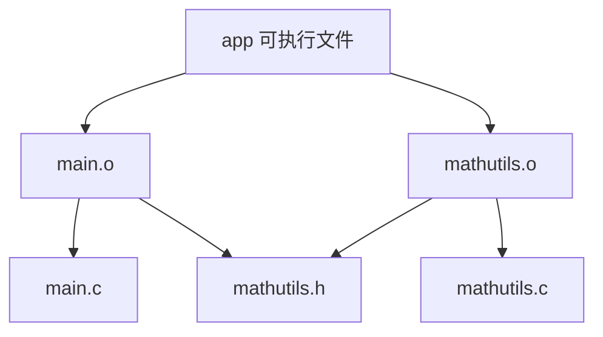

# 第 2 章 构建系统的分层与概念

> 本章目标:建立构建系统的"心智模型"。理解依赖图、目标、规则、增量构建;分清**构建执行器**与**构建配置生成器**;理解配置/生成/构建三阶段、源码外构建、单/多配置生成器;认识 Ninja 以及其他常见构建工具。这一章是后面学习 make / CMake / Meson 的总地图。

**本章结构**

1. 构建系统的核心概念
2. 增量构建的原理
3. 执行器 vs 生成器
4. 三个阶段:配置、生成、构建
5. 源码内构建 vs 源码外构建
6. 单配置与多配置生成器
7. Ninja 简介
8. 其他构建工具概览
9. 同一个项目的三种写法预览
10. 小结与练习

---

## 2.1 构建系统的核心概念

### 2.1.1 目标、依赖、规则

| 概念 | 含义 | 示例 |
|---|---|---|
| **目标(target)** | 要生成的东西 | `app`、`main.o`、`libfoo.a`,也可以是"动作"如 `clean`、`test` |
| **依赖(dependency/prerequisite)** | 生成目标所需的输入 | `main.o` 依赖 `main.c` 与 `mathutils.h` |
| **规则/配方(rule/recipe)** | 由依赖生成目标的命令 | `gcc -c main.c -o main.o` |

用一句话概括:**目标 ← 依赖,通过规则生成**。

### 2.1.2 依赖图(DAG)

以第 1 章的 demo 为例:



文本形式:

```
app
├── main.o
│    ├── src/main.c
│    └── include/mathutils.h
└── mathutils.o
     ├── src/mathutils.c
     └── include/mathutils.h
```

这是一个**有向无环图(DAG, Directed Acyclic Graph)**:

- **有向**:箭头表示"依赖于"。
- **无环**:不能出现 A 依赖 B、B 又依赖 A,否则永远无法构建(构建系统会报循环依赖错误)。
- **叶子节点**是源文件(没有规则,是输入)。
- **根节点**是最终要生成的目标。

构建系统的本质工作就是三件事:

1. **读入**依赖图(来自 Makefile / `build.ninja` 等);
2. **判断**哪些目标过期(out-of-date);
3. **按拓扑顺序**执行过期目标的规则(无依赖关系的可以**并行**)。

### 2.1.3 拓扑顺序与并行

上图中 `main.o` 与 `mathutils.o` 互不依赖,可以同时编译;`app` 必须等它们都完成。

```
时间 →
core1: [编译 main.o      ]
core2: [编译 mathutils.o ]
core1:                    [链接 app]
```

这就是 `make -j4`、`ninja`(默认并行)能提速的原因。**依赖写得越准确,并行越安全;依赖漏写,并行时就会出现随机失败。**

### 2.1.4 目标的种类

- **文件目标**:对应磁盘上的真实文件,靠**时间戳**判断是否过期。
- **伪目标(phony target)**:不对应文件,仅表示"一个动作",总是执行,如 `clean`、`install`、`test`、`all`。
- **中间目标**:只为生成其他目标而存在(如 `.o`)。
- **聚合目标**:没有命令,只聚合依赖,如 `all: app tests docs`。

### 2.1.5 隐式知识 vs 显式规则

构建系统可分为两类思路:

| 思路 | 说明 | 代表 |
|---|---|---|
| 显式规则型 | 你(或生成器)明确写出"目标—依赖—命令" | make、Ninja |
| 高层描述型 | 你只描述"有哪些库/可执行文件,各自源文件、依赖谁",由工具推导规则 | CMake、Meson、Bazel |

---

## 2.2 增量构建的原理

### 2.2.1 基于时间戳(make 的模型)

判断规则:**如果目标不存在,或任一依赖比目标更新(mtime 更大),则目标过期,需重建。**

```
$ ls -l --time-style=full-iso
main.c        10:00:00
main.o        10:00:05     ← 比 main.c 新,不需重编
```

修改 `main.c` 后:

```
main.c        10:10:00     ← 变新了
main.o        10:00:05     → 过期,重编
```

**传播**:`main.o` 变新 → `app` 比 `main.o` 旧 → `app` 也过期,重新链接。**变化沿依赖图向上传播**。

**实验**:

```bash
touch include/mathutils.h
make           # 两个 .o 都重编(因为都依赖该头文件),再链接
touch src/main.c
make           # 只重编 main.o,再链接
make           # 什么都不做:"up to date"
```

### 2.2.2 其他判断方式

| 方式 | 原理 | 优缺点 |
|---|---|---|
| 时间戳 | 比较 mtime | 快;但时钟漂移、`git checkout` 改变 mtime 等会误判 |
| 内容哈希 | 比较输入文件内容的哈希 | 更准确(内容没变就不重编);计算有开销。Bazel、SCons、ccache 采用 |
| 命令行变化检测 | 记录上次执行的命令,命令变了就重建 | Ninja(`.ninja_log`)、Meson 经由 Ninja 实现:改了编译选项会自动重编 |

> make 默认**不会**感知编译选项变化:改了 `CFLAGS` 后 `make` 仍可能说 "up to date"。这是 make 的经典局限(需要自己写技巧或 `make clean`)。

### 2.2.3 头文件依赖是增量构建的难点

`main.o` 真正依赖的不只是 `main.c`,还有它 `#include` 的所有头文件(包括间接包含的)。解决办法:让编译器生成依赖信息(`gcc -MMD -MP`),构建系统读入。

- make:需要手动配置 `-include $(DEPS)`(第 6 章)。
- CMake / Meson:**自动处理**(生成的 Ninja 文件里声明了 `depfile`)。

这是使用高层生成器的重要好处之一。

### 2.2.4 "过度重编"与"漏编"

| 错误 | 症状 | 原因 |
|---|---|---|
| 漏编(under-build) | 改了代码但程序行为没变化/出现诡异崩溃 | 依赖没写全(典型:漏写头文件依赖) |
| 过度重编(over-build) | 改一点点就重编大半项目,速度慢 | 依赖写得太粗,或头文件包含过多 |

构建系统的目标:**既不漏编,也不过度重编**。

---

## 2.3 构建执行器 vs 构建配置生成器

这是理解 make / CMake / Meson 关系的**最关键**一节。

### 2.3.1 两层架构

```
┌───────────────────────────────────────────────┐
│  你写的:CMakeLists.txt / meson.build           │  ← 高层描述 (what)
└───────────────┬───────────────────────────────┘
                │  CMake / Meson 读取、检测环境、生成
                ▼
┌───────────────────────────────────────────────┐
│  生成的:Makefile / build.ninja / .sln / .xcodeproj │  ← 低层规则 (how)
└───────────────┬───────────────────────────────┘
                │  make / ninja / msbuild / xcodebuild 执行
                ▼
┌───────────────────────────────────────────────┐
│  调用:gcc / clang / cl / ld / ar ...           │  ← 编译器与工具链
└───────────────────────────────────────────────┘
                ▼
          .o  .a  .so  app
```

- **构建执行器(build executor / build tool)**:读取低层规则,**判断哪些要重建并执行命令**。如 `make`、`ninja`、`msbuild`。
- **构建配置生成器(meta build system / build generator)**:读取高层描述,**检测环境并生成**执行器能读的文件。如 CMake、Meson、Autotools、GN、premake。

> 常见误解:"CMake 是构建系统"。严格地说,CMake 是**元构建系统**,它自己不编译代码;真正编译的是 make/ninja 等。

### 2.3.2 对比

| | 构建执行器 | 构建配置生成器 |
|---|---|---|
| 代表 | make、Ninja、MSBuild、xcodebuild | CMake、Meson、Autotools、GN、premake、xmake(兼具) |
| 输入 | Makefile、`build.ninja` | `CMakeLists.txt`、`meson.build`、`configure.ac` |
| 关心 | 依赖图、时间戳、并行、执行命令 | 平台/编译器检测、选项、依赖查找、生成多种后端 |
| 抽象层次 | 低(具体命令) | 高(目标、库、属性) |
| 是否跨平台 | 否(命令依赖平台) | 是(同一份描述生成不同平台的构建文件) |
| 手写难度 | 简单项目易写,大项目痛苦 | 一般手写高层描述 |

### 2.3.3 make 的特殊之处

make **既能当执行器,也能被当作"手写的低层规则语言"**:小项目直接手写 Makefile;大项目让 CMake 生成 Makefile。所以 make 横跨了"手写"与"被生成"两种用法。

### 2.3.4 同一个高层描述,多种后端

```bash
cmake -S . -B build -G "Unix Makefiles"   # 生成 Makefile → 用 make 构建
cmake -S . -B build -G Ninja              # 生成 build.ninja → 用 ninja 构建
cmake -S . -B build -G "Visual Studio 17 2022"   # 生成 .sln → 用 msbuild/VS 构建
cmake -S . -B build -G Xcode              # 生成 .xcodeproj → 用 Xcode 构建

meson setup build --backend ninja         # 默认
meson setup build --backend vs2022
meson setup build --backend xcode
```

无论后端是什么,**统一入口**可以是:

```bash
cmake --build build          # CMake 自动调用相应后端
meson compile -C build       # Meson
```

---

## 2.4 三个阶段:配置、生成、构建

以 CMake 为例(Meson 类似,只是名称略有不同):

### 2.4.1 阶段一:配置(Configure)

- **做什么**:解析 `CMakeLists.txt`;检测编译器、系统、库、头文件;处理选项(`-DFOO=ON`);执行 `find_package`;写入缓存。
- **输出**:`CMakeCache.txt`(缓存变量)、`CMakeFiles/` 里的检测结果。
- **耗时**:主要花在编译器检测、`try_compile`、`find_package` 上。

### 2.4.2 阶段二:生成(Generate)

- **做什么**:根据配置结果,计算所有目标、依赖、生成器表达式的最终值,写出后端构建文件。
- **输出**:`Makefile` / `build.ninja` / `.sln` / `compile_commands.json` 等。
- CMake 中"配置+生成"通常在一次 `cmake` 命令里连续完成,控制台最后一行显示 `-- Configuring done`、`-- Generating done`。

> 为什么拆成两步?**生成器表达式**(`$<...>`,第 12 章)要等到生成阶段才求值,因为只有那时才知道每个目标的最终属性和配置(Debug/Release)。

### 2.4.3 阶段三:构建(Build)

- **做什么**:由执行器读取生成的文件,按依赖图执行编译、链接。
- **命令**:`make` / `ninja` / `cmake --build`。
- 之后可选:**测试**(`ctest`)、**安装**(`cmake --install`)、**打包**(`cpack`)。

### 2.4.4 完整流程示意

```
        配置+生成 (慢一些,通常只做一次)             构建 (反复执行)
 ┌──────────────────────────────────────┐   ┌────────────────────┐
 │ cmake -S . -B build -DCMAKE_BUILD_TYPE=Release │──▶│ cmake --build build  │
 └──────────────────────────────────────┘   └────────────────────┘
  产出:build/CMakeCache.txt                    产出:build/app
        build/build.ninja
        build/compile_commands.json
```

### 2.4.5 什么时候会自动重新配置?

修改了 `CMakeLists.txt` 或 `meson.build` 后,直接 `ninja`/`make`,构建系统会**自动**先重新运行 cmake/meson(因为生成的构建文件里,"build.ninja 依赖 CMakeLists.txt"这一条规则本身就在依赖图里)。这就是"构建文件自己也是构建目标"的思想。

### 2.4.6 三阶段对照表

| 阶段 | CMake | Meson | Autotools |
|---|---|---|---|
| 配置 | `cmake -S . -B build` | `meson setup build` | `./configure` |
| 构建 | `cmake --build build` | `meson compile -C build` | `make` |
| 测试 | `ctest --test-dir build` | `meson test -C build` | `make check` |
| 安装 | `cmake --install build` | `meson install -C build` | `make install` |
| 修改选项 | `cmake -DX=Y build` / ccmake | `meson configure build -DX=Y` | 重新 `./configure --xxx` |
| 打包 | `cpack` | `meson dist` | `make dist` |

---

## 2.5 源码内构建 vs 源码外构建

### 2.5.1 定义

| | 源码内构建(in-source) | 源码外构建(out-of-source) |
|---|---|---|
| 构建目录 | 就是源码目录 | 独立目录(如 `build/`) |
| 命令 | `cmake .` | `cmake -S . -B build` |
| 产物位置 | 与源码混在一起 | 全在 `build/` |

### 2.5.2 为什么推荐源码外构建

1. **干净**:`rm -rf build` 就彻底清除所有产物,不会污染源码,`git status` 干净。
2. **多配置并存**:同一份源码可同时有多个构建目录。

```bash
cmake -S . -B build-debug   -DCMAKE_BUILD_TYPE=Debug
cmake -S . -B build-release -DCMAKE_BUILD_TYPE=Release
cmake -S . -B build-clang   -DCMAKE_CXX_COMPILER=clang++
cmake -S . -B build-arm     -DCMAKE_TOOLCHAIN_FILE=arm.cmake
```

3. **源码只读**也能构建(如在只读目录或共享目录上)。
4. **避免污染**:in-source 的 CMake 会产生 `CMakeCache.txt`、`CMakeFiles/`、`Makefile` 等一堆文件,清理困难。

> **Meson 强制要求源码外构建**:`meson setup .` 会报错。CMake 允许 in-source,但强烈不建议;可在顶层加防护:

```cmake
if(CMAKE_SOURCE_DIR STREQUAL CMAKE_BINARY_DIR)
  message(FATAL_ERROR "禁止源码内构建,请使用: cmake -S . -B build")
endif()
```

### 2.5.3 典型目录布局

```
demo/                    ← 源码目录 (CMAKE_SOURCE_DIR)
├── CMakeLists.txt
├── include/
├── src/
└── build/               ← 构建目录 (CMAKE_BINARY_DIR),可随时删除
    ├── CMakeCache.txt
    ├── build.ninja
    ├── compile_commands.json
    ├── CMakeFiles/
    └── app
```

### 2.5.4 make 的源码外构建

纯 make 默认是 in-source 的(`.o` 生成在当前目录),但可通过变量管理输出目录(第 6、8 章):

```makefile
BUILD_DIR := build
OBJ := $(SRC:src/%.c=$(BUILD_DIR)/%.o)
```

---

## 2.6 单配置生成器与多配置生成器

### 2.6.1 概念

"配置(configuration)"指 Debug / Release / RelWithDebInfo / MinSizeRel 等**构建类型**。

| 类型 | 含义 | 代表生成器 |
|---|---|---|
| **单配置生成器** | 一个构建目录只对应**一个**配置,在**配置阶段**确定 | Unix Makefiles、Ninja、MinGW Makefiles、NMake |
| **多配置生成器** | 一个构建目录包含**所有**配置,在**构建阶段**选择 | Visual Studio、Xcode、`Ninja Multi-Config` |

### 2.6.2 用法差异(CMake)

**单配置**:配置时指定,之后不能换

```bash
cmake -S . -B build -G Ninja -DCMAKE_BUILD_TYPE=Release
cmake --build build
# 要换 Debug?需要另一个目录,或重新配置
```

**多配置**:配置时不指定,构建时用 `--config`

```bash
cmake -S . -B build -G "Visual Studio 17 2022"
cmake --build build --config Debug
cmake --build build --config Release
ctest --test-dir build -C Release
cmake --install build --config Release
```

### 2.6.3 对 CMake 脚本编写的影响

- `CMAKE_BUILD_TYPE` **只对单配置生成器有效**;多配置用 `CMAKE_CONFIGURATION_TYPES`。
- 不能在 `CMakeLists.txt` 里 `if(CMAKE_BUILD_TYPE STREQUAL "Debug")` 来判断多配置的 Debug(此时值为空)。
- 正确做法是用**生成器表达式** `$<CONFIG:Debug>`(第 12 章):

```cmake
target_compile_definitions(app PRIVATE $<$<CONFIG:Debug>:DEBUG_MODE>)
```

- 单配置下没指定 `CMAKE_BUILD_TYPE` 时通常是空(无优化无调试信息),常见做法是设置默认值:

```cmake
get_property(is_multi GLOBAL PROPERTY GENERATOR_IS_MULTI_CONFIG)
if(NOT is_multi AND NOT CMAKE_BUILD_TYPE)
  set(CMAKE_BUILD_TYPE Release CACHE STRING "" FORCE)
endif()
```

### 2.6.4 Meson 的做法

Meson 使用 `buildtype` / `debug` / `optimization` 选项,每个构建目录一个配置(相当于单配置):

```bash
meson setup build-debug   --buildtype=debug
meson setup build-release --buildtype=release
```

即使使用 VS 后端,Meson 也是一个构建目录一种配置。

### 2.6.5 对比

| | 单配置 | 多配置 |
|---|---|---|
| 配置选择时机 | 配置阶段 | 构建阶段 |
| 目录数量 | 每配置一个目录 | 一个目录搞定 |
| 输出路径 | `build/app` | `build/Debug/app.exe`、`build/Release/app.exe` |
| 典型平台 | Linux/macOS 命令行 | Windows VS、macOS Xcode |

---

## 2.7 Ninja 简介

### 2.7.1 定位

**Ninja** 是由 Google 工程师(Evan Martin)为 Chromium 开发的小型构建执行器,目标是 **"速度"**。它的哲学是:

> **Ninja 不是用来手写的,而是用来被生成的。**

它故意把语言设计得极其简单,不提供变量展开技巧、函数、条件判断、通配符等,把"聪明"的部分交给 CMake/Meson/GN 这样的生成器。

### 2.7.2 `build.ninja` 示例

对第 1 章的 demo,一份手写的 `build.ninja`:

```ninja
cflags = -Iinclude -Wall -O2

rule cc
  command = gcc $cflags -MMD -MF $out.d -c $in -o $out
  description = CC $out
  depfile = $out.d
  deps = gcc

rule link
  command = gcc $in -o $out
  description = LINK $out

build build/main.o:      cc src/main.c
build build/mathutils.o: cc src/mathutils.c
build build/app:         link build/main.o build/mathutils.o

default build/app
```

运行:

```bash
ninja
# [3/3] LINK build/app
ninja -v        # 显示完整命令
ninja -t clean  # 清理
ninja -t targets
ninja -t graph | dot -Tpng -o graph.png   # 画依赖图
ninja -t compdb cc > compile_commands.json
ninja -n        # dry run
ninja -j8       # 指定并行数
```

**语法要点**

- `rule`:定义命令模板,`$in` / `$out` 是输入/输出。
- `build 输出: 规则名 输入`:一条构建边。
- `depfile` + `deps = gcc`:自动读取 gcc 生成的头文件依赖,读完后存入 `.ninja_deps` 数据库(比保留 `.d` 文件更快)。
- 变量 `cflags = ...` 是简单的字符串变量。
- `default`:默认目标;`phony`:伪目标;`pool`:限制并行任务数(如链接阶段内存吃紧时);`subninja`、`include`:引入其他文件。

### 2.7.3 为什么 Ninja 快

1. **极简的数据模型**:解析 `build.ninja` 非常快,无变量求值/函数/隐含规则,启动延迟极低(对超大项目尤为明显:make 可能思考几秒,ninja 几乎瞬时)。
2. **没有隐含规则**:不会花时间搜索内置规则。
3. **默认并行**:自动按 CPU 核数并行(`-j` 默认约为核数+2);输出自动缓冲,不会交错。
4. **持久化数据库**:`.ninja_log`(命令与时间戳)、`.ninja_deps`(头文件依赖)让重新检查依赖更快,并能检测**命令行变化**。
5. **精确的依赖**:依赖信息由生成器严格给出。
6. **输出简洁**:默认只显示进度 `[12/87] CC ...`(单行刷新),需要时 `-v`。

### 2.7.4 Ninja 与 make 的定位差异

| 维度 | make | Ninja |
|---|---|---|
| 语言能力 | 变量、函数、条件、模式规则、shell | 极简,几乎只有 rule/build |
| 主要使用方式 | 手写 + 被生成 | **被生成** |
| 隐含规则 | 有(如 `%.o:%.c`) | 无 |
| 默认并行 | 否(需 `-j`) | 是 |
| 大项目启动速度 | 较慢 | 极快 |
| 命令变化检测 | 无 | 有 |
| 头文件依赖 | 需自己用 `-MMD` + `include` | `depfile`/`deps` 原生支持 |
| 输出 | 完整命令 | 简洁进度行 |
| 安装 | 几乎处处都有 | 需安装(常随 CMake/VS 提供) |

**结论**:现代项目中,**CMake/Meson + Ninja** 是最主流、最快的组合;make 更常见于小项目、教学、遗留项目、以及作为任务入口。

---

## 2.8 其他构建工具概览

### 2.8.1 总览表

| 工具 | 类型 | 描述语言 | 特点 | 典型使用者 |
|---|---|---|---|---|
| **make** | 执行器 | Makefile | 历史悠久、无处不在 | 大量传统项目、Linux 内核(Kbuild) |
| **Ninja** | 执行器 | `build.ninja` | 快,被生成 | Chromium、LLVM 等(经 CMake/GN) |
| **MSBuild** | 执行器 | XML(`.vcxproj`) | .NET/Visual Studio 原生 | Windows 项目 |
| **Autotools**(autoconf/automake/libtool) | 生成器 | `configure.ac` + `Makefile.am` | 生成可移植的 `configure` 脚本与 Makefile;`./configure && make && make install` | GNU 软件、老牌开源项目 |
| **CMake** | 生成器 | CMake 语言 | 生态最广,IDE 支持最好 | 绝大多数现代 C/C++ 项目 |
| **Meson** | 生成器 | 类 Python DSL | 快速、易读、默认 Ninja | GNOME、systemd、Mesa、GStreamer |
| **Bazel** | 一体化(高层+执行) | Starlark(`BUILD`) | 沙箱、哈希缓存、远程缓存/执行、多语言、可复现 | Google、大型 monorepo |
| **Buck / Buck2** | 一体化 | Starlark | 类似 Bazel,Meta 出品 | Meta |
| **Pants** | 一体化 | Python | 偏 Python/JVM/Go monorepo | |
| **GN** | 生成器 | GN 语言 | 生成 Ninja,为超大规模设计 | Chromium、Fuchsia |
| **SCons** | 一体化 | Python | 用 Python 写构建脚本,哈希判断过期 | 部分游戏/科学项目,速度较慢 |
| **xmake** | 一体化 | Lua | 自带包管理,简单易用 | 国内较常见 |
| **Premake** | 生成器 | Lua | 生成 VS/Makefile/Xcode 工程 | 游戏、跨平台工程 |
| **qmake** | 生成器 | `.pro` | Qt 传统构建系统,Qt 6 起转向 CMake | 老 Qt 项目 |
| **Gradle/Maven** | 一体化 | Groovy/Kotlin/XML | JVM 生态(Android 也可调用 CMake/ndk-build 编译 native 部分) | Java/Kotlin |
| **Cargo** | 一体化 | TOML | Rust 官方,构建+包管理 | Rust |
| **go build** | 一体化 | 无 | Go 官方 | Go |
| **ndk-build** | 执行器 | `Android.mk` | Android NDK 老方案 | Android 老项目 |

### 2.8.2 Autotools 一览(重点了解流程)

```
configure.ac ──autoconf──▶ configure   (脚本,探测系统特性)
Makefile.am  ──automake──▶ Makefile.in
                 ./configure
Makefile.in + config.h.in ───────▶ Makefile + config.h
                 make && make install
```

**优点**:不要求用户安装 autotools,只需 shell 与 make;**缺点**:语法晦涩(m4 宏)、慢、对 Windows 友好度差、难维护。因此新项目多转向 CMake/Meson。

### 2.8.3 Bazel 一览

和 CMake/Meson 的根本区别:

- **一体化**:自己做依赖分析、调度、缓存。
- **封闭(hermetic)构建**:沙箱中运行,所有输入必须显式声明,结果可复现。
- **内容哈希缓存**:本地/远程缓存,团队共享。
- **适合超大 monorepo**,但上手与外部 C++ 库集成成本较高。

### 2.8.4 如何选择(预告,详见第 19 章)

- 小工具、学习、脚本任务 → **make**
- 通用 C/C++ 项目、跨平台、需要 IDE 支持 → **CMake**(+ Ninja)
- Linux 桌面/系统类项目、追求简洁易读 → **Meson**
- 超大规模、多语言 monorepo → **Bazel/Buck/GN**
- 维护老项目 → 看现状(Autotools 等)

---

## 2.9 同一个项目的三种写法预览

仍用第 1 章的 demo(`include/mathutils.h`、`src/main.c`、`src/mathutils.c`),这里先"看个眼熟",后面章节会逐行讲解。

### 2.9.1 make

**Makefile**

```makefile
CC      := gcc
CFLAGS  := -Wall -O2 -Iinclude
SRC     := $(wildcard src/*.c)
OBJ     := $(SRC:src/%.c=build/%.o)

app: $(OBJ)
	$(CC) $^ -o $@

build/%.o: src/%.c | build
	$(CC) $(CFLAGS) -c $< -o $@

build:
	mkdir -p build

clean:
	rm -rf build app

.PHONY: clean
```

使用:

```bash
make -j4
./app
make clean
```

> 注意:这个版本没处理头文件依赖(第 6 章会改进),也没有源码外输出可执行文件。它直观展示了"目标:依赖 + 命令"。

### 2.9.2 CMake

**CMakeLists.txt**

```cmake
cmake_minimum_required(VERSION 3.20)
project(demo LANGUAGES C)

add_executable(app src/main.c src/mathutils.c)
target_include_directories(app PRIVATE include)
target_compile_options(app PRIVATE -Wall)
```

使用:

```bash
cmake -S . -B build -G Ninja -DCMAKE_BUILD_TYPE=Release
cmake --build build
./build/app
```

> 注意:头文件依赖、`.o` 输出目录、Debug/Release 都不需要手写,CMake 自动处理。

### 2.9.3 Meson

**meson.build**

```meson
project('demo', 'c',
  default_options : ['warning_level=2'])

inc = include_directories('include')

executable('app',
  ['src/main.c', 'src/mathutils.c'],
  include_directories : inc)
```

使用:

```bash
meson setup build --buildtype=release
meson compile -C build
./build/app
```

### 2.9.4 三者的角色再对照

| | make | CMake | Meson |
|---|---|---|---|
| 你写的是 | **具体规则**(怎么做) | **目标描述**(是什么) | **目标描述**(是什么) |
| 谁来执行 | make 自己 | make 或 Ninja 等 | 默认 Ninja |
| 头文件依赖 | 手动 | 自动 | 自动 |
| 构建目录 | 手动管理 | 天然源码外 | 强制源码外 |
| 配置与构建分离 | 无(直接构建) | 有 | 有 |

---

## 2.10 编译数据库 `compile_commands.json`(预告)

无论使用哪种生成器,**IDE、clangd、clang-tidy** 等工具都需要知道"每个源文件是怎么编译的"。业界约定的格式:

```json
[
  {
    "directory": "/home/me/demo/build",
    "command": "gcc -Iinclude -Wall -O2 -c ../src/main.c -o main.o",
    "file": "../src/main.c"
  }
]
```

生成方法:

| 工具 | 方法 |
|---|---|
| CMake | `-DCMAKE_EXPORT_COMPILE_COMMANDS=ON`(仅 Makefile/Ninja 生成器支持) |
| Meson | 自动生成在构建目录 |
| Ninja | `ninja -t compdb` |
| make | 使用 `bear -- make` 或 `compiledb make` |

---

## 2.11 本章小结

1. 构建系统本质:维护一个**依赖图(DAG)**,依据**时间戳(或哈希)**找出过期目标,按**拓扑顺序**执行规则,独立的节点可**并行**。
2. **执行器**(make、Ninja)负责"怎么执行";**生成器**(CMake、Meson、Autotools)负责"检测环境、生成执行器的输入"。**CMake 和 Meson 自身都不编译代码**。
3. 构建流程分为**配置 → 生成 → 构建**(→ 测试 → 安装 → 打包);修改构建描述文件后会自动重新配置。
4. **始终使用源码外构建**,Meson 强制,CMake 推荐。
5. 注意**单配置**(Makefile/Ninja)与**多配置**(VS/Xcode)生成器的差异,尤其是 CMake 里 `CMAKE_BUILD_TYPE` 与生成器表达式 `$<CONFIG:>` 的用法。
6. **Ninja** 是为"被生成"而设计的高速执行器,与 CMake/Meson 是黄金搭档。
7. 工具生态:Autotools(传统)、Bazel/Buck/GN(超大规模)、xmake/premake/SCons(其他选择),本教程重点是 **make → CMake → Meson**。

## 2.12 练习

1. 画出你自己某个项目(或第 1 章 demo)的依赖图,标出哪些节点可以并行构建。
2. 用 `touch` 实验 2.2.1 的增量构建传播:分别触碰头文件、某个 `.c` 文件,观察 `make` 重建了什么(用 `make -n` 先预览)。
3. 手写 2.7.2 的 `build.ninja`,执行 `ninja`、`ninja -v`、再改 `cflags` 观察 ninja 是否自动重编(对比 make 的行为)。
4. 用 CMake 的三个生成器(Unix Makefiles / Ninja / 若在 Windows 则 Visual Studio)配置同一个 demo,观察构建目录里生成了什么文件。
5. 分别创建 `build-debug` 与 `build-release` 两个目录,比较可执行文件体积;并用 `grep CMAKE_BUILD_TYPE build-*/CMakeCache.txt` 验证。
6. 尝试在源码目录直接执行 `cmake .`(in-source),观察生成了多少杂物,然后清理;再用 `meson setup .` 看会提示什么。
7. 思考题:为什么说"CMake 不是构建系统"?为什么 Ninja 故意不支持变量函数和通配符?
8. 思考题:多配置生成器下,`if(CMAKE_BUILD_TYPE STREQUAL "Debug")` 为什么不可靠?

## 2.13 术语速查

| 术语 | 说明 |
|---|---|
| target | 构建目标(文件或动作) |
| prerequisite / dependency | 依赖 |
| recipe / rule | 规则/命令 |
| DAG | 有向无环图 |
| phony target | 伪目标 |
| out-of-date | 目标过期,需要重建 |
| incremental build | 增量构建 |
| build executor | 构建执行器(make/ninja) |
| meta build system / generator | 元构建系统/构建生成器(CMake/Meson) |
| configure / generate / build | 配置 / 生成 / 构建 |
| in-source / out-of-source | 源码内 / 源码外构建 |
| single-config / multi-config | 单配置 / 多配置生成器 |
| depfile | 编译器输出的头文件依赖文件 |
| compile_commands.json | 编译数据库 |
| hermetic build | 封闭、可复现构建 |
