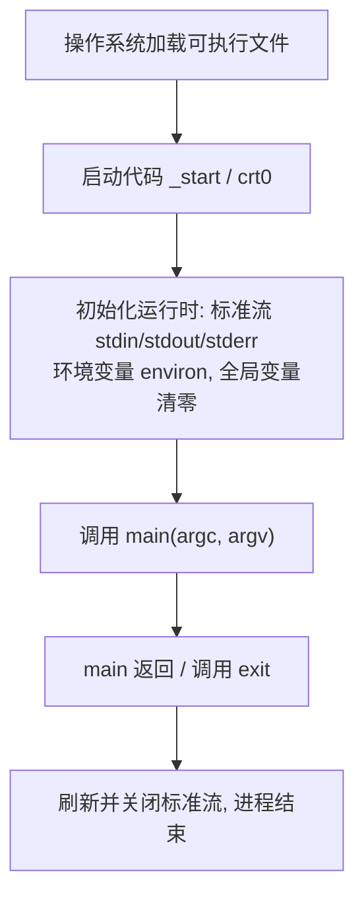

# C 语言中的"默认全局变量"详解

> **先说结论：** C 语言**本身没有**"内置的全局变量"这种语法概念。
> 你平时感觉"不用定义就能用"的那些东西，来源有三类：
>
> 1. **标准库通过头文件提供的全局对象**（如 `errno`、`stdin`、`stdout`、`stderr`）
> 2. **编译器预定义的宏/标识符**（如 `__FILE__`、`__LINE__`、`__func__`），它们**不是变量**，但常被误当成变量
> 3. **POSIX / 操作系统扩展提供的全局变量**（如 `environ`、`optarg`、`optind`），**不属于 ISO C 标准**，Windows 的 MSVC 下不一定有

---

## 1. 总览表

| 名称                                          | 是什么                               | 来自哪里  | 头文件                       | 作用                    |
| ------------------------------------------- | --------------------------------- | ----- | ------------------------- | --------------------- |
| `errno`                                     | 宏（展开为 `int` 左值）                   | ISO C | `<errno.h>`               | 保存最近一次库函数/系统调用的错误码    |
| `stdin`                                     | 宏（类型 `FILE *`）                    | ISO C | `<stdio.h>`               | 标准输入流                 |
| `stdout`                                    | 宏（类型 `FILE *`）                    | ISO C | `<stdio.h>`               | 标准输出流                 |
| `stderr`                                    | 宏（类型 `FILE *`）                    | ISO C | `<stdio.h>`               | 标准错误流                 |
| `__FILE__` `__LINE__` `__DATE__` `__TIME__` | 预定义宏                              | ISO C | 无需包含                      | 当前文件名、行号、编译日期、编译时间    |
| `__STDC__` `__STDC_VERSION__`               | 预定义宏                              | ISO C | 无需包含                      | 标明遵循的 C 标准版本          |
| `__func__`                                  | 预定义标识符（函数内 `static const char[]`） | C99 起 | 无需包含                      | 当前函数名                 |
| `environ`                                   | 全局变量 `char **`                    | POSIX | 需自行 `extern` 声明（或部分系统头文件） | 环境变量表                 |
| `optarg` `optind` `opterr` `optopt`         | 全局变量                              | POSIX | `<unistd.h>`              | 配合 `getopt()` 解析命令行选项 |
| `tzname` `timezone` `daylight`              | 全局变量                              | POSIX | `<time.h>`                | 时区信息（由 `tzset()` 设置）  |
| `argc` / `argv`                             | **不是全局变量**，是 `main` 的形参           | ISO C | —                         | 命令行参数                 |

---

## 2. 这些东西在内存里大概在哪？

下面是典型 Linux 进程的内存布局（**示意图，具体细节因系统/编译器而异**）：

```
高地址
┌──────────────────────────────────────┐
│  命令行参数字符串 / 环境变量字符串      │ ← argv[]、environ 指向这里
├──────────────────────────────────────┤
│  栈 stack（局部变量、main 的形参）  ↓   │ ← argc、argv 本身在这里
│                                      │
│            ……（空闲区域）……            │
│                                      │
│  堆 heap（malloc 分配）             ↑   │
├──────────────────────────────────────┤
│  .bss   未初始化/零初始化的全局、静态变量 │ ← 你自己写的 int g; 在这里
├──────────────────────────────────────┤
│  .data  已初始化的全局、静态变量         │ ← 例如 glibc 中的 stdin/stdout 指针
├──────────────────────────────────────┤
│  .rodata 只读数据（字符串常量等）        │ ← __FILE__ 展开出的字符串常量
├──────────────────────────────────────┤
│  .text  代码段                        │
└──────────────────────────────────────┘
低地址

另：errno 在支持多线程的实现中通常放在"线程局部存储 (TLS)"，
    每个线程各有一份，不在上面的公共 .data/.bss 里。
```

程序启动到 `main` 的大致流程：



---

## 3. `errno`：错误码

### 作用
很多库函数失败时会返回 `-1`、`NULL` 之类的"失败信号"，但不会告诉你**为什么**失败。原因被写进 `errno`。

### 要点
- 头文件：`<errno.h>`
- 从 C11 起标准要求 `errno` 是**线程局部**的（每个线程一份）。
- 它是宏，不一定是真正的全局变量名。所以**不要自己写 `extern int errno;`**。
- ISO C 标准只强制要求 `EDOM`、`ERANGE`、`EILSEQ` 三个错误码；`ENOENT` 等是 POSIX 的。
- **只有在函数明确报告失败后才去读 `errno`**；成功的调用**不保证**把它清零。
- 具体错误码的数值因系统而异，请用宏名比较，不要写死数字。

### 例子 1：打开不存在的文件

```c
#include <stdio.h>
#include <errno.h>
#include <string.h>

int main(void) {
    FILE *fp = fopen("no_such_file.txt", "r");
    if (fp == NULL) {
        printf("errno = %d\n", errno);
        printf("含义  = %s\n", strerror(errno));  // 把错误码转成文字
        // 直接打印: fopen: No such file or directory
        perror("fopen");                          
        return 1;
    }
    fclose(fp);
    return 0;
}
```

在 Linux 上，典型输出类似：

```
errno = 2
含义  = No such file or directory
fopen: No such file or directory
```

### 例子 2：`strtol` 溢出检测（先清零再判断）

```c
#include <stdio.h>
#include <stdlib.h>
#include <errno.h>

int main(void) {
    char *end;
    errno = 0;                                   // 调用前手动清零
    long v = strtol("99999999999999999999", &end, 10);
    if (errno == ERANGE) {
        puts("数值超出 long 范围");
    } else {
        printf("v = %ld\n", v);
    }
    return 0;
}
```

### 图示：errno 的工作方式

```
  你的代码                    库函数 fopen
     │  fopen("x.txt","r")        │
     ├───────────────────────────▶│  失败!
     │                            │  ① 把错误码写入 errno (如 ENOENT)
     │◀───────────────────────────┤  ② 返回 NULL
     │ 返回 NULL                   │
     │ 检查 errno → 知道原因        │
```

### 常见坑：`errno` 会被后续调用覆盖

```c
FILE *fp = fopen("a.txt", "r");
if (!fp) {
    printf("open failed\n");        // printf 自己也可能修改 errno!
    perror("fopen");                // 这里的 errno 可能已不是 fopen 的
}

/* 更稳妥: 先保存 */
if (!fp) {
    int saved = errno;
    printf("open failed\n");
    fprintf(stderr, "error: %s\n", strerror(saved));
}
```

---

## 4. `stdin` / `stdout` / `stderr`：三个标准流

### 作用
程序启动时，运行时环境自动为你打开三个文件流：

| 流 | 默认连接到 | 典型用途 | 缓冲（标准的规定） |
|---|---|---|---|
| `stdin` | 键盘 | 读取输入 | 交互设备时不是全缓冲 |
| `stdout` | 屏幕 | 正常输出 | **不是交互设备时才全缓冲**（终端通常行缓冲） |
| `stderr` | 屏幕 | 错误信息 | **不是全缓冲**（通常无缓冲） |

> 说明：`printf(...)` 等价于 `fprintf(stdout, ...)`；`scanf(...)` 等价于 `fscanf(stdin, ...)`。

### 例子：区分正常输出与错误输出

```c
#include <stdio.h>

int main(void) {
    fprintf(stdout, "这是正常结果\n");
    fprintf(stderr, "这是错误信息\n");
    return 0;
}
```

在 shell 里可以分别重定向：

```bash
./a.out > out.txt          # 只有"正常结果"进 out.txt，错误信息仍显示在屏幕
./a.out 2> err.txt         # 只有"错误信息"进 err.txt
./a.out > out.txt 2>&1     # 两个都进 out.txt
```

### 图示

```
              ┌────────────┐
  键盘 ──────▶│   stdin    │──▶ scanf / getchar / fgets(buf,n,stdin)
              └────────────┘

              ┌────────────┐
  printf ────▶│   stdout   │──▶ 屏幕（或被 > 重定向到文件/管道）
              └────────────┘

              ┌────────────┐
  perror ────▶│   stderr   │──▶ 屏幕（或被 2> 重定向）
              └────────────┘
```

### 常见坑：缓冲导致输出顺序错乱

```c
printf("A");                 // 没有 \n，可能还留在 stdout 缓冲区
fprintf(stderr, "B\n");      // stderr 立刻输出
// 终端上看到的顺序可能是: B 先, A 后（或在输出被重定向/管道时更明显）
fflush(stdout);              // 想强制刷新，就调用 fflush
```

> 另外：这三个是**宏**（类型 `FILE *`）。在 glibc 中它们对应真正的全局指针变量，但在其他系统（例如 macOS）底层名字不同。所以**不要对 `stdin` 等取"变量式"假设，只把它们当作 `FILE *` 表达式用**。

---

## 5. 预定义宏与 `__func__`（它们不是变量）

### 作用
编译时由**预处理器**直接替换成常量，常用于日志和调试。

| 名称 | 展开为 | 类型 |
|---|---|---|
| `__FILE__` | 当前源文件名（字符串字面量） | `char[]` |
| `__LINE__` | 当前行号 | 整数常量 |
| `__DATE__` | 编译日期，如 `"Sep 28 2026"` | 字符串 |
| `__TIME__` | 编译时间，如 `"14:30:05"` | 字符串 |
| `__STDC__` | 通常为 `1`，表示遵循标准 C | 整数 |
| `__STDC_VERSION__` | 标准版本号，如 C99 是 `199901L`，C11 是 `201112L`，C17 是 `201710L` | `long` |
| `__func__`（C99） | 当前函数名 | 函数内的 `static const char[]`，**是标识符不是宏** |

### 例子：写一个带位置信息的日志宏

```c
#include <stdio.h>

#define LOG(msg) \
    fprintf(stderr, "[%s:%d %s()] %s\n", __FILE__, __LINE__, __func__, msg)

void foo(void) {
    LOG("进入 foo");
}

int main(void) {
    LOG("程序开始");
    foo();

    #if defined(__STDC_VERSION__)
    printf("C 标准版本宏 = %ldL\n", (long)__STDC_VERSION__);
    #endif
    return 0;
}
```

典型输出（文件名等取决于你的环境）：

```
[demo.c:11 main()] 程序开始
[demo.c:7 foo()] 进入 foo
C 标准版本宏 = 201710L
```

### 图示：宏在编译前被替换

```
源代码:   LOG("hi");           位于 demo.c 第 11 行, 函数 main 内
             │
             ▼ 预处理器展开
fprintf(stderr, "[%s:%d %s()] %s\n", "demo.c", 11, __func__, "hi");
                                       ▲          ▲
                                   字面量替换   __func__ 由编译器在函数内提供
```

> `__LINE__` 每次展开都是**它所在那一行**的行号，因此适合写在宏里。

---

## 6. POSIX 扩展的全局变量（非 ISO C，Linux/macOS 常见）

### 6.1 `environ`：环境变量表

```c
#include <stdio.h>

extern char **environ;   // 需要自己声明（不同系统头文件是否声明不一致）

int main(void) {
    for (char **e = environ; *e != NULL; e++) {
        puts(*e);        // 形如 "PATH=/usr/bin:/bin"
    }
    return 0;
}
```

图示：

```
environ ──▶ ┌─────────────┐
            │ ptr ────────┼──▶ "HOME=/home/user"
            ├─────────────┤
            │ ptr ────────┼──▶ "PATH=/usr/bin:/bin"
            ├─────────────┤
            │ ptr ────────┼──▶ "LANG=en_US.UTF-8"
            ├─────────────┤
            │ NULL        │   ← 以 NULL 结尾
            └─────────────┘
```

> 只想读单个环境变量，用标准函数 `getenv("HOME")` 更简单、也更可移植。

### 6.2 `optarg` / `optind` / `opterr` / `optopt`：配合 `getopt`

| 变量 | 作用 |
|---|---|
| `optarg` | 当前选项带的参数（如 `-o file` 中的 `file`） |
| `optind` | 下一个要处理的 `argv` 下标；循环结束后指向第一个非选项参数 |
| `opterr` | 设为 `0` 可关闭 `getopt` 自动打印的错误信息 |
| `optopt` | 遇到无法识别的选项时，保存该选项字符 |

```c
#include <stdio.h>
#include <unistd.h>

int main(int argc, char *argv[]) {
    int opt;
    const char *out = "a.out";
    int verbose = 0;

    while ((opt = getopt(argc, argv, "vo:")) != -1) {
        switch (opt) {
        case 'v': verbose = 1;      break;
        case 'o': out = optarg;     break;   // optarg 指向 "-o" 后面的参数
        case '?': fprintf(stderr, "未知选项: -%c\n", optopt); return 1;
        }
    }

    printf("verbose=%d, out=%s\n", verbose, out);
    for (int i = optind; i < argc; i++)      // optind 之后是普通参数
        printf("文件参数: %s\n", argv[i]);
    return 0;
}
```

运行示例：

```
$ ./prog -v -o result.txt a.c b.c
verbose=1, out=result.txt
文件参数: a.c
文件参数: b.c
```

### 6.3 `tzname` / `timezone` / `daylight`

由 `tzset()`（`localtime` 等也会隐式调用）设置，保存本地时区信息。日常开发中很少直接使用。

---

## 7. 容易混淆的：`argc` / `argv` 不是全局变量

```c
int main(int argc, char *argv[]) { ... }
```

它们是 `main` 的**形参**，位于栈上，只在 `main` 内可见。想在别的函数里用，需要把它们传过去，或自己存到全局变量里。

```
$ ./prog hello world

argc = 3
argv ──▶ ┌────┐
         │ ●──┼──▶ "./prog"
         │ ●──┼──▶ "hello"
         │ ●──┼──▶ "world"
         │NULL│
         └────┘
```

---

## 8. 顺带一提：你自己定义的全局变量有"默认值"

这才是 C 里真正意义上的"默认值"规则：**具有静态存储期**的变量（全局变量、`static` 变量）在没有显式初始化时，会被自动初始化为 **0**（指针为 `NULL`，浮点为 `0.0`）；局部变量则**不会**，值是不确定的。

```c
#include <stdio.h>

int g_count;              // 全局: 自动为 0
static double g_ratio;    // 静态: 自动为 0.0
char *g_name;             // 全局指针: 自动为 NULL

int main(void) {
    int local;            // 局部: 值不确定！不要读取
    printf("%d %f %p\n", g_count, g_ratio, (void *)g_name);
    // 输出: 0 0.000000 (nil) 或 0x0（%p 的显示格式因实现而异）
    (void)local;
    return 0;
}
```

---

## 9. 常见易错点小结

1. **`errno` 不是每次调用都会重置**：判断前先清零（如 `strtol`），并且只在函数报告失败后读取。
2. **不要写 `extern int errno;`**：应包含 `<errno.h>`。
3. **`__func__` 只能在函数内使用**，不是宏；`__FILE__`、`__LINE__` 是宏。
4. **`environ`、`optarg` 等不是标准 C**：在 Windows/MSVC 上不能想当然使用（MSVC 有类似的 `_environ` 等，名字和行为不同，具体请查文档，这里我不做保证）。
5. **`stdout` 有缓冲**：混合使用 `stdout` 和 `stderr` 时输出顺序可能与代码顺序不一致。
6. **不要把 `argc/argv` 当全局变量**。

---

## 10. 速查：这些名字来自哪个标准？

```
ISO C 标准 ──┬─ errno, stdin, stdout, stderr
             ├─ __FILE__, __LINE__, __DATE__, __TIME__, __STDC__, __STDC_VERSION__
             └─ __func__ (C99 起)

POSIX 扩展 ──┬─ environ
             ├─ optarg, optind, opterr, optopt   (<unistd.h>)
             └─ tzname, timezone, daylight       (<time.h>)

编译器/系统私有 ── 例如 glibc 的 program_invocation_name 等
                   （我只确定它们存在于 glibc，不同版本细节请查官方文档）
```

---

## 11. 关于本文的不确定之处（诚实声明）

- 内存布局图是**典型示意**，不同操作系统、编译器、是否开启 PIE/ASLR 等都会影响实际情况。
- 错误码的具体数值（如 `ENOENT` 是 `2`）和 `perror` 的文字内容，因系统而异，示例输出以 Linux 为例。
- 关于"glibc 中 `stdin` 对应真实全局指针、macOS 底层名字不同"这类**实现细节**，仅作说明，不建议依赖。
- 除 `environ`、`getopt` 系列、`tzname` 系列外，POSIX/各系统还有其他全局变量（如 `h_errno`、`signgam` 等），本文未逐一展开。
